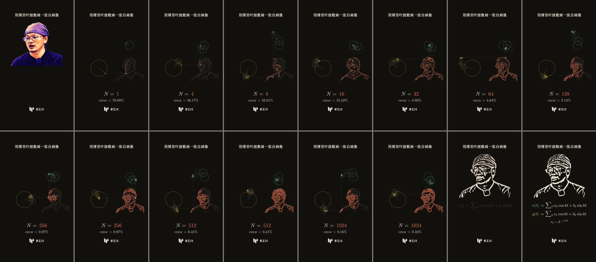

# 傅里叶画像 · Fourier Portrait


把一张人像照片做成竖版短视频：照片溶解成线稿，一串旋转的圆（傅里叶本轮）把整张脸一笔画出来，
圆的数量从 1 加到 1024，误差同步下降，最后揭晓线稿与级数公式。



## 安装

```bash
npx lovstudio skills add fourier-portrait -g -y
```

本地开发时，也可以把源目录链接进 Agent 的 skills 目录：

```bash
ln -s "$(pwd)" "${LOVSTUDIO_SKILLS_INSTALL_DIR:?请设置本地 Skills 目录}/lov-fourier-portrait"
```

## 使用

对 Agent 说：

- “用傅里叶级数把这张自拍画出来，做成竖版视频”
- “参考这条旋转圆画脸的视频，用我的照片也做一个，换成单链那种”

也可以直接运行脚本（`uv` 会按脚本内的依赖声明自动准备环境）：

```bash
# 先出质检静帧，几秒完成
uv run scripts/fourier_portrait.py --photo selfie.heic --workdir work --stills-only

# 正式渲染：1080×1920、30fps、约 39 秒
uv run scripts/fourier_portrait.py --photo selfie.heic --workdir work \
  --out output/videos/fourier-portrait.mp4 --title "用傅里叶级数画一张自画像" --logo logo-white.png
```

常用参数：

| 参数 | 作用 |
| --- | --- |
| `--mode xy\|complex` | `xy` 是双链（顶部 x、左侧 y，默认）；`complex` 是单链，肖像更大 |
| `--offset` / `--min-area` / `--crop` | 调节线稿的墨量、碎点和裁切，见 `references/tuning.md` |
| `--stages` / `--stage-seconds` | 每轮的圆数量与时长 |
| `--stills-only` | 只出质检静帧 |

产物在 `--workdir` 中：`lineart.png`、`stills_sheet.jpg`、`video_sheet.jpg`、`report.json`（每轮误差、衰减指数、ffprobe 结果）。成片不带音轨，配乐交给剪辑环节。

## 原理与开源参考

技术本身就是“路径 → FFT → 按振幅排序的旋转向量”。这类视频常用 manim（3Blue1Brown）或
p5.js（Coding Train #130）实现。本 Skill 用 Apple Vision 抠图，用 OpenCV 出线稿，
连通各段轮廓时用最小生成树避免长连线，再用 numpy FFT 计算，最后由 skia 渲染并直接送进
ffmpeg。完整对比见 [`references/prior-art.md`](references/prior-art.md)。

## 用户 Profile（跨 session）

`skill.yaml` 声明了 `user-profile/v1`。本 Skill 的长期记录放在
`skills.lov-fourier-portrait.records`，包括 `photo`、`logo`、`title`、`output_dir` 和 `mode`。
用户明确说“以后都用这张照片”之类的话时，由 `scripts/profile_store.py` 写回。
详见 [`references/user-profile.md`](references/user-profile.md)。

## 原子组合

上游可选 `lov-media-crawler`（下载参考视频），下游可选 `lov-media-creator`（配乐、剪辑）
和 `lov-media-publisher`（发布），只通过文件交接。详见
[`references/skill-composition.md`](references/skill-composition.md)。

## 可信度卡与用户案例

- [`skill-card.yaml`](skill-card.yaml) / [`skill-card.md`](skill-card.md)：用途、依赖、风险、输出与维度地图
- [`cases/cases.json`](cases/cases.json)：真实 Input → Prompt → Output 案例
- [`pricing-card.yaml`](pricing-card.yaml)：价值锚点、交付边界与复评条件

## 质量门

```bash
python3 scripts/validate_skill.py .
```

## 依赖

- `uv`，或 Python 3.10+ 并装有 numpy、opencv-python-headless、scipy、skia-python、matplotlib
- ffmpeg / ffprobe
- 可选：macOS 14+ 与 Swift，用于 Apple Vision 抠图和人脸裁切
- 中文标题需要含 CJK 字形的字体（`--font`，默认 `Songti SC`）
- PyYAML（仅用于 profile 与校验脚本）

## License

MIT
