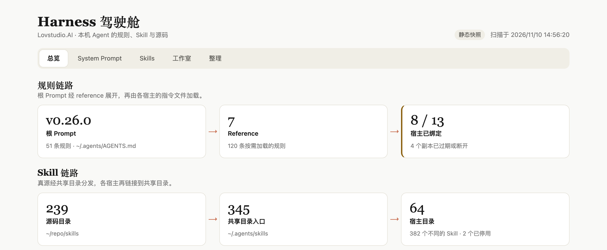

# Harness 驾驶舱 · Harness Cockpit


一屏看清本机 Agent 的规则、Skill 与源码，并把发现的问题可撤销地整理掉。



## 它回答的问题

| 页签 | 你能看到 |
| --- | --- |
| System Prompt | 根 Prompt 的规则结构与版本、每个 reference 是否被路由、规则引用的本机路径是否还在、各宿主的指令文件是链接、副本还是已经过期 |
| Skills | 每个宿主装了哪些 Skill、描述占了多少字符；断开的链接、重名、别名、绕经其他宿主的链接、没有 `SKILL.md` 的目录 |
| 工作室 | 自己维护的 Skill 源码：各处版本号是否一致、有没有未提交或未推送、与目录和镜像的版本差、是否已安装 |
| 整理 | 把可以自动处理的问题放进整理篮，先看逐步计划，确认后执行，执行过的可以撤销 |

## 安装

```bash
npx lovstudio skills add harness
```

从源码安装（开发或离线时）：在本仓库根目录执行，先登记到共享目录，再让宿主链接过去。

```bash
mkdir -p ~/.agents/skills ~/.claude/skills
ln -s "$(pwd)" ~/.agents/skills/lov-harness
ln -s ../../.agents/skills/lov-harness ~/.claude/skills/lov-harness
```

其他宿主把最后一行的 `~/.claude/skills` 换成各自的 Skill 目录即可。

## 使用

对 Agent 说“打开 Harness 驾驶舱，看看我本机的 system prompt 和 skills”，或者直接运行脚本。

**看全貌**

```bash
python3 scripts/harness.py serve --open
```

输出里的 `dashboard=` 一行是地址。驾驶舱默认只读：可以浏览、搜索、查看原文、运行校验、预览整理计划，
不会改动任何文件。

**只要结论**

```bash
python3 scripts/harness.py report --limit 12
```

得到一份 Markdown 摘要：三块内容的规模、各级别的问题数，以及每个区域最严重的问题与它们的 ID。

**留档或发给别人**

```bash
python3 scripts/harness.py export --out ./harness.html
```

得到一个不依赖服务的单文件只读驾驶舱。它包含你的规则摘要与 Skill 列表，外发前先看一眼。

## 整理与撤销

```bash
# 预览：只打印计划
python3 scripts/harness.py tidy --fix-code SKL-BROKEN-LINK

# 确认后执行；输出批次号与撤销命令
python3 scripts/harness.py tidy --fix-code SKL-BROKEN-LINK --apply

# 停用一个 Skill：移出共享目录，并移除各宿主指向它的链接
python3 scripts/harness.py tidy --disable some-skill --apply

# 撤销最近一次
python3 scripts/harness.py undo --apply
```

想在界面里勾选并执行，用 `serve --allow-write` 启动。

安全边界：

- 只增删符号链接、在共享目录与停用目录之间移动条目、把散落文件移入整理备份。
- 不删除实体文件，不改写文件内容，不触碰 Skill 源码仓库，不执行 Git 写操作。
- 每一步执行前重新核对前提；每个批次都有记录，可以撤销。
- 驾驶舱只监听回环地址，接口需要页面内的一次性令牌。

全部检查项与整理动作见 [`references/checks.md`](references/checks.md)。

## 配置

不配置也能用：共享配置目录默认是 `~/.agents`，源码根目录和目录文件会按本机现状推断，
结果和来源都显示在输出里。需要指定时：

| 位置 | 参数 | 环境变量 |
| --- | --- | --- |
| 共享配置目录 | `--agents-home` | `LOV_HARNESS_AGENTS_HOME` |
| Skill 源码根目录 | `--source-root` | `LOV_HARNESS_SOURCE_ROOT` |
| 目录文件 `skills.yaml` | `--catalog` | `LOV_HARNESS_CATALOG` |
| 整理记录目录 | `--state-dir` | `LOV_HARNESS_STATE_DIR` |

## 用户 Profile（跨 session）

`skill.yaml` 声明了 `user-profile/v1`。本 Skill 从共享 Profile 读取源码根目录
（`workspace.skill_repos_root`）、品牌名（`brand.name`）和它自己的长期记录
（`skills.lov-harness.records`）。用户直接说出的长期设置由 `scripts/profile_store.py` 写回
Profile；推断出来的值不会写入。详见 [`references/user-profile.md`](references/user-profile.md)。

## 原子组合

[`references/skill-composition.md`](references/skill-composition.md) 记录了已检查的相邻 Skill、
上下游交接与重叠处理。本 Skill 是 Single Skill：它发现问题，把内容优化、发布和规则改写交给
对应的能力，不把任何 sibling Skill 当作运行依赖。

## 可信度卡与用户案例

- [`skill-card.yaml`](skill-card.yaml) / [`skill-card.md`](skill-card.md)：用途、依赖、风险、输出与维度地图。
- [`cases/cases.json`](cases/cases.json)：真实的 Input → Prompt → Output 案例。
- [`pricing-card.yaml`](pricing-card.yaml)：价值锚点、交付边界与复评条件。

## 质量门

```bash
python3 scripts/harness.py selftest     # 扫描、整理、撤销与驾驶舱接口
python3 scripts/validate_skill.py .     # 源码结构
```

## 依赖

- Python 3.9+（仅标准库）
- git（可选，用于源码仓库状态）
- PyYAML（可选，用于目录对照与严格的 frontmatter 校验；`validate_skill.py` 需要它）
- 浏览器（仅驾驶舱需要）
- 已在 macOS 上验证；Linux 预期可用，尚未实测

## License

MIT
