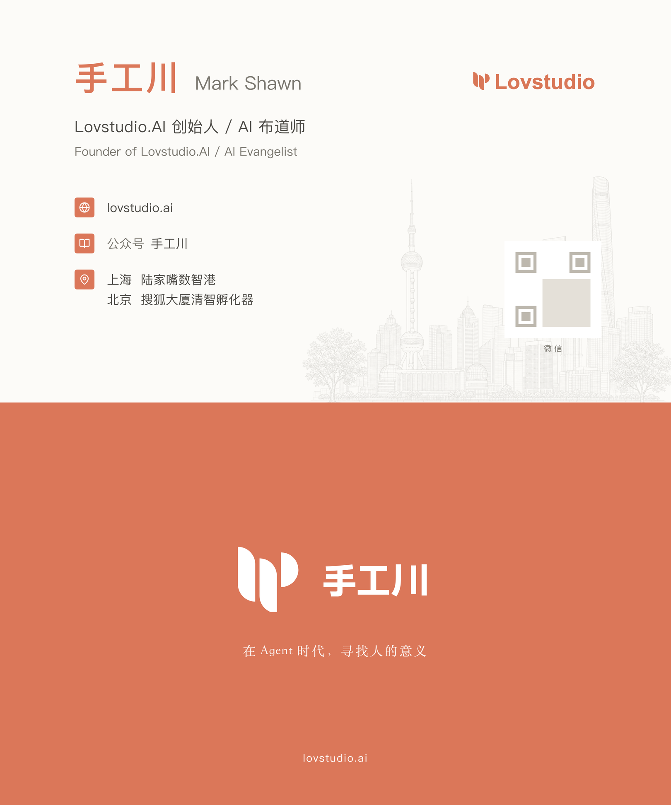

# Jessy 名片设计 · Jessy Card Design


克隆 Jessy 那张横版机构名片的版式与信息层级，换成你的品牌与真实资料：左上主色姓名配双语职务，
右上品牌标，方块图标联络行，右下地标线稿衬二维码，背面主色铺底居中 Logo。输出正面、背面、
正反拼图三张 PNG 和一个可直接在浏览器打开的自包含 HTML，并回读二维码。



## 安装

```bash
npx skills add lov-jessy-style-card-design -g -y
```

本地源码安装：

```bash
ln -s "$(pwd)" "${LOVSTUDIO_SKILLS_INSTALL_DIR:?请设置本地 Skills 目录}/lov-jessy-style-card-design"
```

## 使用

对 Agent 说：

- “按 Jessy 那张名片的样式给我做一张。”
- “Jessy 式名片，给我同事也做一张，资料我发你。”
- "Clone the Jessy card design for our brand."

Agent 会先列出每个槽位用哪份资料、来自哪里，再从模板写 spec、渲染、检查、回读二维码。

手动渲染模板（中性示例素材）：

```bash
python3 scripts/render_card.py assets/jessy-style.card.json --out-dir ./out --version v0.1
python3 scripts/verify_qr.py "./out/jessy-style-card-正反-<日期>-v0.1.png" --expect-same-as assets/jessy-style/sample-qr.png
```

## 脚本

| 脚本 | 作用 |
| --- | --- |
| `scripts/render_card.py` | 按块级 JSON spec 出 HTML 与 PNG，自带越界、重叠、溢出检查 |
| `scripts/verify_qr.py` | 多尺度解码二维码，默认只报 host 与摘要 |
| `scripts/lineart.py` | 白底线稿转透明单色墨线（ImageMagick） |
| `scripts/gen_illustration.py` | 经 OpenRouter 生成无字地标线稿 |
| `scripts/profile_store.py` | 读写共享用户 Profile |

版式规则见 [references/jessy-style.md](references/jessy-style.md)，spec 字段见
[references/layout-spec.md](references/layout-spec.md)。

## 用户 Profile（跨 session）

`skill.yaml` 声明 `user-profile/v1`：从共享 Profile 读姓名、职务、联系方式、品牌名、网址、Logo、主色、
输出目录；本 Skill 的长期记录（文件名前缀、永不上名片的信息）存在 `skills.lov-jessy-style-card-design.records`。
详见 [references/user-profile.md](references/user-profile.md)。

## 原子组合

`lov-iris-style-card-design` 是同族的另一套版式；资料与随附消息的语气可由 `lov-wdb-cowork` 从微信会话取出；
线稿可由图像 Skill 生成；不指定参考时用 `lov-business-card`。详见
[references/skill-composition.md](references/skill-composition.md)。

## 可信度卡与用户案例

- [skill-card.yaml](skill-card.yaml) / [skill-card.md](skill-card.md)
- [cases/cases.json](cases/cases.json)：真实案例，回放与交付逐像素一致
- [pricing-card.yaml](pricing-card.yaml)

## 质量门

```bash
python3 scripts/validate_skill.py .
```

## 依赖

- Python 3.9+
- Chrome、Chromium 或 Edge
- 可选：ImageMagick 7、opencv-python、`OPENROUTER_API_KEY`

## License

MIT
